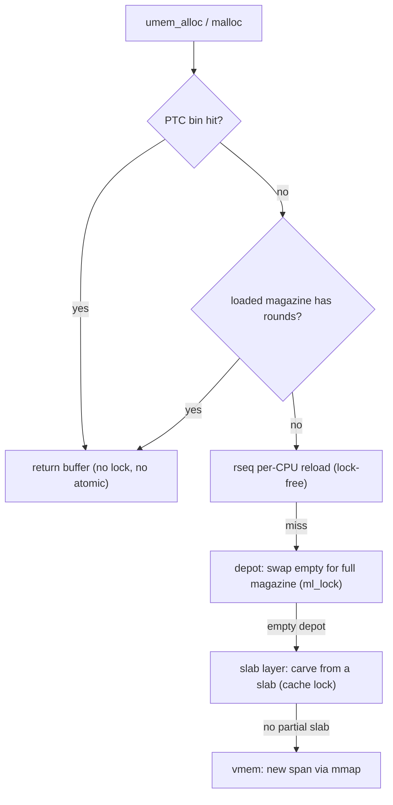

The slab layer is correct but contended: every alloc and free would touch a
cache's lock. The magazine layer, from Bonwick & Adams' 2001 paper, puts a
stack of per-CPU (and in this port, per-thread) caches in front of it so the
common case never reaches the slab lock. libumem has three tiers.

## Magazines

A **magazine** is a fixed-size stack of object pointers -- think of it as a
clip of pre-allocated buffers. Allocation *pops* the top
(`mag_round[--rounds]`); free *pushes* (`mag_round[rounds++]`). A magazine
is **LIFO**: the last buffer freed is the next one handed out, which keeps
the returned buffer cache-hot. This LIFO property matters elsewhere -- it is
why libumem keeps forward-only freelist mangling and declined snmalloc's
involution encoding; see [Freelist mangling]({{ '/design/freelist-mangling/' | relative_url }}).

## The depot

The **depot** is the per-cache reservoir of full and empty magazines, behind
a mutex (`ml_lock`). When a per-CPU cache empties its loaded magazine, it
swaps the empty for a full one from the depot's full list; when it fills,
it returns a full magazine and takes an empty. A magazine goes on the full
list only when it is *exactly* full (P1.3c: a stale-magazine path used to
discard populated magazines, destroying exactly 127 objects per discard;
fixed). The depot keeps per-CPU arrays to avoid cross-CPU contention on the
cold path.

{: .note }
> This port replaced the earlier lock-free striped-array depot with the
> straightforward mutex-protected list of the original Bonwick & Adams
> design, removing ~280 lines of complexity. Simpler, and correct.

## The per-thread cache (PTC)

Above the per-CPU layer sits the **per-thread cache**: a set of per-size
*bins* of object pointers, plus two magazines (`loaded` and `previous`) that
refill from the depot. The PTC is the lock-free fast path for allocations up
to `tcache_max` (default 8192 bytes since P8.2b). A per-thread-cache hit is
served with no atomic and no lock; a bin miss falls to the thread's two
magazines, and only a miss there reaches the depot.

The PTC is on by default. `UMEM_OPTIONS=tcache=0` disables it;
`tcache_max=N` lowers the ceiling.

{: .warning }
> `perthread_cache=0` does **not** disable the PTC and never did in this
> port. That is Solaris's byte-sized knob, accepted for compatibility and
> read by nothing. Use `tcache=0`.

### The per-CPU hint bug (P8.2)

For most of this port's life, *every thread shared one per-CPU cache*. The
CPU hint was `pthread_self()` cast to `int` -- a page-aligned address, so
`hint & cache_cpu_mask` was **0 for every thread**, and the whole process
serialized on one `cc_lock` for every operation that reached the magazine
layer. Objects of 1-4 KB collapsed to 0.06-0.10x glibc at 64+ threads.
Solaris uses `thr_self()`, a small integer; this port never had a working
hint until `ae86536` fixed it (4-18x on both metals up to 64 threads).

### Priming the second level (P8.6)

Even after the hint fix, each thread's two magazines took from the depot by
*trylock only*, and nothing ever gave them a magazine -- so every object past
a bin's capacity paid up to ten *failed* lock/unlock pairs and then the
per-CPU lock. One thread, 512 B, alloc-N-free-N: 6.0 Mpairs/s at N=128
(27x slower than N=64) before the fix; 137 after (`a2177b9`).

## The hierarchy, end to end

Each tier exists to keep traffic off the tier below it. Steady-state
single-size workloads live almost entirely in the PTC bins; the depot and
slab layers are touched only when a thread's working set changes size.

## What it costs

This hierarchy is why libumem's cross-thread-handoff tail latency
(`prodcons` p999, 0.9 us sustained at 8 threads) is among the best in the
field, and also why its RSS runs ~1.5x the live set at 64-256 B: warm
magazines and bins hold freed buffers rather than returning them
immediately. That trade is the slab-allocator trade, accepted as such. The
measured numbers and their null controls are in the
[results]({{ '/reference/limits/' | relative_url }}) and the README.
