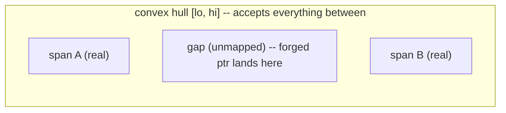

When `free(p)` is called -- especially through the `LD_PRELOAD` drop-in,
where `p` may not even be a libumem pointer -- the allocator must decide
whether it owns `p` before it touches `p`'s header. Get this wrong and a
forged pointer leads to a write to attacker-influenced memory.

## The convex-hull mistake

Until v3.3.1, `umem_may_own()` answered the ownership question with a
**convex hull**: the lowest and highest addresses libumem had ever mapped.
A pointer inside `[lo, hi]` was accepted. But libumem's heap is not one
contiguous range -- it is many `mmap` spans with *gaps between them*. A
forged header landing in a gap, between two real spans, passed the hull
check. For sizes under 128 KiB it would then go onto a per-thread free list
and later be handed back by `malloc()`.

## P7.4: exact containment

`free()` now confirms *exact* containment against a sorted **span table**
published lock-free by `vmem_span_create`. Each real span is an entry; a
pointer is owned only if it falls inside an actual entry, not merely inside
the hull.

The cost is paid only by pointers that need it:

- A **normal heap free short-circuits on the hull bounds** first and pays
  nothing new -- measured within the null control on both architectures.
- A **foreign pointer** (one the hull accepts) pays a bounded binary search
  of the span table.

The table is a fixed 16 Ki entries. On saturation it falls back to the hull
-- a conservative *false-yes* that can never become accept-all; the earlier
estimate of ~80 spans was wrong (it is thousands), which is why the table is
sized as it is and why the fallback exists.

## Compared to the field

This now matches jemalloc's exact rtree ownership test and is stronger than
glibc, which has no range check at all on `free()`. Regression:
`test/security/test_forged_span_gap`, which fails on the parent commit
(the forged gap pointer is accepted and returned) and passes after.

{: .note }
> The ordering with the [freelist mangling]({{ '/design/freelist-mangling/' | relative_url }})
> matters: the span table decides *whether* `p` is ours before any header
> read, and the mangling protects the links *inside* buffers that are ours.
> They defend different steps of the same `free()`.
